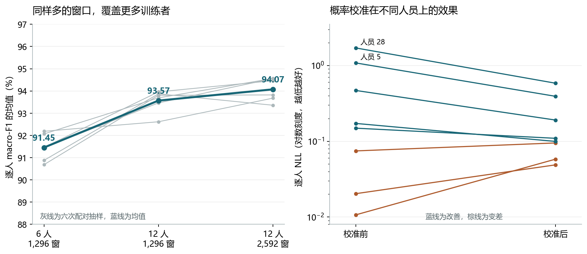

# 轻量人体活动识别：六个方向的开发集先导实验

**2026 年 11 月 27 日。** 如果目标是解决 UCI HAR 的跨人员泛化，优先研究固定标注预算下应覆盖多少训练者。如果目标是保留知识蒸馏作为论文核心，优先验证小学生是否真的需要教师为每个样本单独给出提示。外部数据混合和增加时间跨度都得到了有条件的结果。

## 补数据时，来自谁比窗口总数更值得检验

| 研究问题 | 本轮观察 | 对选题的判断 |
|---|---|---|
| 固定窗口数，覆盖更多人有用吗？ | UCI 六分类，同为 1,296 窗，6 人改为 12 人，逐人 macro-F1 均值从 91.45% 升至 93.57%。六次配对均为正。固定 12 人再将窗口翻倍，均值升至 94.07%。 | 最适合先亲手复现。可以在同一数据集内检验人员覆盖，再讨论增加另一批人员是否值得。[协议与数据](uci_people/README.md) |
| 加入另一个手机数据集能缓解 UCI 过拟合吗？ | 五分类共同特征 MLP，以 50:50 混合训练替代仅 UCI 训练，UCI 验证 macro-F1 为 84.81% → 83.01%，NLL 为 0.416 → 0.504；MotionSense 验证 macro-F1 为 26.03% → 81.65%。 | 支持扩展口袋手机场景的覆盖。若目标只看 UCI，当前配方缺少正向证据。事后复用混合组每一步的 UCI 半批，仍观察到混合组的 UCI 损失更高。[协议与数据](pooling/README.md) |
| 不额外训练模型，过度自信能缓解多少？ | UCI 教师从第 25 轮到第 80 轮，平均 NLL 从 0.302 升到 0.460；用另四人的标签拟合单一温度，分别降到 0.185、0.197。第 80 轮校准使 5 人改善，3 人变差。 | 以后并列报告分类表现和概率质量。可用这种低成本方法诊断“过拟合”主要影响哪项指标。[协议与数据](uci_people/README.md) |

## 如果保留知识蒸馏，教师提供了什么？

| 研究问题 | 本轮观察 | 对选题的判断 |
|---|---|---|
| 教师的提示需要对应每个窗口吗？ | UCI 六分类 MLP，用真实逐窗提示或同类训练窗的平均提示，逐人 macro-F1 均值分别为 95.302% 和 95.301%，NLL 为 0.2102 和 0.2117。同类内交换提示为 95.22%，直接标签平滑也为 95.22%。 | 值得带到较难的 MotionSense CNN 上：一个类别只存一份软目标就可能接近逐样本蒸馏。当前结果来自一个固定教师和三次学生初始化；尚无正式等效性结论。[三种教师目标的构造](uci_people/targets.py) · [分组结果](uci_people/targets.csv) |
| 扩大学生的局部时间跨度会提高蒸馏收益吗？ | MotionSense，1,126 参数、两种跨度、两种训练方法。比较“38 点的 KD−LS”减“14 点的 KD−LS”，在第 4、12、40 轮分别为 +1.98、−4.96、+1.45 个百分点。第 40 轮为事后诊断。 | 训练预算能改变方向。当前降低这一假设的优先级。第 40 轮 KD 的 NLL 在两种跨度上均高于 LS，也说明 F1 与概率质量需要分开看。[协议与数据](temporal/README.md) |
| 多个身体部位的信号会纠正哪些单腕错误？ | PAMAP2 五分类，4 人训练、2 人验证。严格完整窗口上，腕部 67.43%，腕胸踝融合 81.94%。84 个上楼窗中融合纠正 35 个腕部错误，反向为 0；站立的两项计数为 5 和 11。允许短缺失插值后，多部位的整体优势仍在。 | 若想做可穿戴应用，这是最值得保留的备选。下一项可检验训练时获得多部位提示，推理时单腕学生能保留多少上楼收益。本轮融合模型在推理时也用了三处信号。[协议与数据](sensors/README.md) |

## 建议的下一步

1. **学习与数据问题先合在一起。** 先亲手复跑“1,296 窗，6 人对 12 人”的对照，画出每次配对差值。它与“UCI 是人少还是窗少”直接相关，数据处理也最简单。
2. **论文核心只选一项待证假设。** 如果项目继续围绕蒸馏，固定一种轻量 CNN 和一个教师，用同一批次顺序比较直接标签平滑、逐窗教师提示和类平均提示。先确定可接受的差值和训练预算，再看开发结果。传感器路线作为独立备选。
3. **正式评估留到方案冻结。** UCI 的八位开发验证者、MotionSense 的四位及 PAMAP2 的两位分别支撑各自问题。不同方向使用的输入、类别、模型和宏平均口径不同，分数只能在同一行内比较。随机种子重复使用同一批人。联合训练、温度校准、传感器融合分别使用不同的数据与额外信息，不能把三项改进相加。

此次研究只使用开发数据。没有对 UCI 官方测试集、MotionSense 预留测试人员或 PAMAP2 的保留人员做模型评价。每个子目录含可直接运行的源码、分项说明和数值结果。
