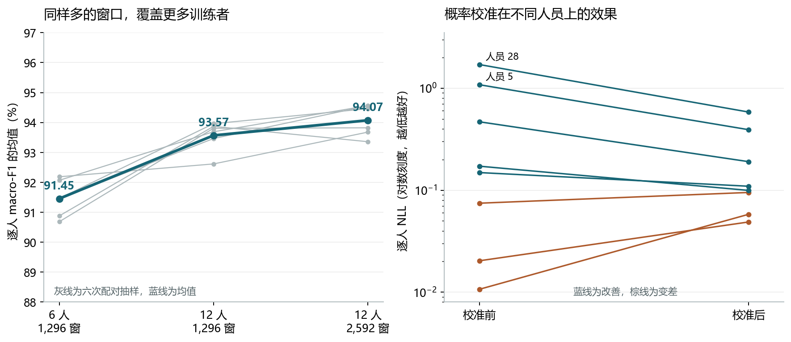

# UCI HAR：训练人员、预测置信度与教师提示

三项开发实验均只读官方 `train/` 中的 561 维特征、标签和人员编号。A 组沿用前期四位验证者 3、28、29、30；另留出 B 组 5、11、21、26。训练候选为其余 13 人。所有方法使用同一组别定义。这两组都属于开发数据，后续正式测试仍可使用封存的官方测试集。

## 一、同样多的窗口，有必要覆盖更多人吗？

每次从 13 名训练候选中随机排列并选取 12 人。固定 561→32→6 的 MLP、Adam、学习率 0.001、400 次更新和每步 128 个样本。在每位训练者的每个类别内无放回抽取窗口，训练批次从选出的窗口中有放回抽取。标准化只使用该条件实际抽中的训练窗口。六次配对同时重抽人员、窗口及模型初始化，同次比较共享模型初值与批次抽样种子。

| 人员和每人每类窗口 | 总训练窗 | F1 | NLL |
|---|---:|---:|---:|
| 6 人 × 36 窗 | 1,296 | 91.45% | 0.259 |
| 12 人 × 18 窗 | 1,296 | 93.57% | 0.198 |
| 12 人 × 36 窗 | 2,592 | 94.07% | 0.181 |

F1 先在每位验证者上对六类等权平均，再对 8 人及配对抽样等权平均。相同窗口预算下，多人条件平均增加 2.11 个百分点，各次差值为 +2.01、+2.99、+3.12、+2.50、+0.43、+1.62。八位验证者的跨抽样均值都提高。固定 12 人、将窗口翻倍增加 0.51 个百分点。六次抽样共用同一验证人群；每个窗口的采集时长及标注成本也不等同于招募新人的成本。[逐次、逐人记录](diversity.csv)

## 二、只改变输出概率，能缓解多少晚期损失？

用全部 13 名训练者训练 561→256→128→6 的交叉熵教师。固定第 25、80 轮，在 A 组拟合温度后评价 B 组，再交换 A 与 B。每次用另四人的平均 NLL 选一个温度，候选覆盖 0.25–8；温度为正，因此每个样本的预测类别保持相同。每人等权，使用三个训练种子。

| 轮数 | 原始 NLL | 校准后 NLL | 逐人 macro-F1 |
|---|---:|---:|---:|
| 25 | 0.302 | 0.185 | 94.49% |
| 80 | 0.460 | 0.197 | 94.63% |

第 80 轮校准后，5 人的平均 NLL 降低，3 人升高。例如 28 号从 1.704 降到 0.583，11 号从 0.011 升到 0.058。换一组人员校准可以缓解整体过度自信，仍会牺牲某些人的概率质量。该对照需要另有标注的校准人员；它与早期 17 人训练的结果属于不同协议。[逐人记录](calibration.csv) · [温度校准方法来源](https://proceedings.mlr.press/v70/guo17a.html)

## 三、逐窗教师提示比每类共用一个提示更有效吗？

另训练一个固定的 561→256→128→6 教师，标签平滑 0.1，固定 40 轮。所有学生均为 561→32→6，在相同 13 名训练者上跑 40 轮；同种子的四个学生共用初始化与批次顺序。蒸馏温度 2，教师权重 0.5，KL 使用 batchmean 并乘温度平方。一次比较使用同一教师，三次改变学生种子。教师只对训练窗口提供提示。

| 学生获得的监督 | 逐人 macro-F1 | NLL |
|---|---:|---:|
| 直接标签平滑 0.1 | 95.22% | 0.2304 |
| 教师对当前窗口的概率向量 | 95.30% | 0.2102 |
| 同类训练窗的教师概率向量均值 | 95.30% | 0.2117 |
| 同类内交换完整概率向量 | 95.22% | 0.2127 |

类平均保留类别间的平均混淆，同时抹平同类内部的信心与分布差异。交换对照保持每类提示集合完全相同，每个窗口都换到另一个同类窗口的提示。逐窗与类平均的 F1 均值相差约 0.001 个百分点。结果提示这套配置的分类表现对逐窗提示依赖很小；该先导没有预设等效性界值，也只训练了一位教师。分类表现接近不代表两个方法的预测概率完全相同。[逐种子、逐人记录](targets.csv)

## 复跑

从本目录使用装有 PyTorch 2.7.1 CPU 和 NumPy 的 Python 依次运行 `python -B run.py`、`python -B targets.py`。两者分别生成前两项及第三项的 CSV。作图另运行 `python -B plot.py`（pandas 和 Matplotlib）。所有结果取固定预算的检查点。历史研究和官方测试文件均无需改动。
