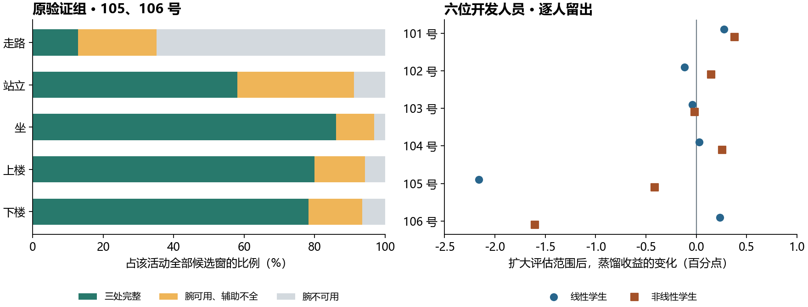

# 多部位训练、单腕部署时，评估应该保留哪些片段？

筛选验证集时，如果要求训练教师使用的所有部位都有信号，就会删掉一部分单腕模型本来可以处理的片段。本实验用开发人员检验两个不同的问题：这样的片段有多少，以及放回它们后，单腕蒸馏相对直接监督的收益是否会改变。

**本轮判断。** PAMAP2 和 OPPORTUNITY 的独立加速度节点都存在额外排除目标端可用窗的情况，但在两套学生模型、两份数据的逐人留出评估中，改用全部目标端可用窗对平均蒸馏收益的影响均不超过 0.30 个 macro-F1 百分点。个体差异和传感器组合效应值得记录。当前证据不足以支撑「完整性筛选系统性夸大蒸馏」的投稿主张。这是开发集的描述性范围，尚未进行等效性检验。

## PAMAP2 的结果

原验证组的 797 个候选窗里，457 个三处完整，160 个腕完整而辅助不全，另有 180 个腕本身不完整。因此 617 个腕端可识别片段中，三处完整筛选会额外排除 25.9%。这一现象在六位开发人员身上都有。走路最具代表性，225 个候选窗分成 29 个三处完整、50 个腕完整而辅助不全、146 个腕不完整。允许短缺失插值后，走路的三项计数变成 169、12、44，五类合计变成 723、29、45。

六人合计 2,456 个候选窗。严格规则下 1,881 个腕可用，其中 351 个因辅助信号而出局（18.7%）；短缺失规则下仅 90 / 2,291 个腕可用窗未通过三处联合要求（3.9%）。

| 开发评估 | 模型 | 完整窗上的蒸馏收益 | 全部腕可用窗上的蒸馏收益 | 范围效应 |
|---|---|---:|---:|---:|
| 原两人验证，严格 | 线性 | −0.73 | −0.64 | +0.09 |
| 原两人验证，严格 | 非线性 | +2.46 | +1.54 | −0.92 |
| 六人逐人留出，严格 | 线性 | +0.03 | −0.26 | −0.30 |
| 六人逐人留出，严格 | 非线性 | +0.22 | +0.01 | −0.21 |
| 六人逐人留出，短缺失插值 | 线性 | −0.02 | +0.01 | +0.03 |
| 六人逐人留出，短缺失插值 | 非线性 | −0.64 | −0.71 | −0.08 |

以上均为逐人宏 F1 百分点，三列差值用未四舍五入的原数计算。在严格六折中，线性学生的 105 号从 +0.71 变为 −1.45，非线性学生的最大范围效应则出现在 106 号（−1.60）。同时，直接训练的单腕线性基线本身在 102、104 号上分别提高 3.74、3.82 个百分点，说明绝对分数和两方法之间的差值可以对同一种筛选有不同反应。



原两人严格完整集的合并窗口结果还复现了此前的单腕基线 67.43% 和三部位教师 81.94%。教师在推理时能使用额外部位，这个差距不会自动转变为学生的增益。使用额外腕端训练数据的非线性直接监督基线，在严格六折的全部腕可用窗上达到 65.40%，对应配对训练窗的蒸馏学生为 64.42%；线性模型在同一口径上的两项结果分别为 65.24% 和 65.44%。这些差异描述当前训练协议，参与者数目不足以划定普适等效界限。

## 外部数据 OPPORTUNITY

选用前三位参与者的 15 段日常活动，按站、走、坐、躺四类分别切窗，共 4,254 个候选窗。第四位参与者预留。两套传感器组合使用同一批活动，先在第一套检查覆盖，再增补一套解剖位置接近腕、躯干、下肢的独立节点。在各组合内，学生只读目标部位，三人逐人留一。传感器部位、设备系列与数据集同时变化的比较，只能定位观测到差异的配置。[UCI 原始数据](https://archive.ics.uci.edu/dataset/226/opportunity+activity+recognition) · [外部审计、原始信号字段与复跑步骤](external/README.md)

| 设备及目标部位 | 三处完整 | 目标可用而辅助不全 | 目标不可用 | 线性学生蒸馏收益，完整 → 全部目标可用 | 非线性学生同项收益 |
|---|---:|---:|---:|---:|---:|
| IMU，右前臂为目标，背及左前臂辅助（原定） | 4,202 | 0 | 52 | −0.64 → −0.64 | +0.23 → +0.23 |
| 独立加速度节点，右腕为目标，背及右膝下辅助（事后增补） | 3,475 | 531 | 248 | +0.45 → +0.38 | −1.52 → −1.35 |

第二套组合中，额外排除的 531 个窗有 74、31、426 个分别来自 S1、S2、S3，占全部腕端可用窗的 13.3%。S3 的直接监督单腕模型在放回目标可用片段后，线性模型从 41.29% 升至 44.28%，非线性模型从 44.22% 升至 47.87%。这说明完整片段在部分人身上甚至更难。短缺失规则与严格规则在这两套配置中得到相同的窗口计数。前三人既是开发数据，也是这组探查的全部证据；个体差异不得外推到整个数据集。[逐人覆盖](external/coverage.csv) · [逐人得分](external/metrics.csv)

## 配对比较

同一折、同一缺失规则下，只训练一次单腕直接监督模型和一次单腕蒸馏模型。两者看到相同的、有标签的三部位配对训练窗，标准化仅使用训练人员。蒸馏教师在训练阶段额外使用另外两处信号。预测一次后，对同一批预测依次评估「三处均可用」「目标部位可用的全部窗口」与两者的差集。目标部位也缺失的窗只进入覆盖统计。此处的部署范围仅指活动标签已知、时间足够长、目标传感器满足质量规则的窗口。

单腕基线使用每类总权重相同的交叉熵。蒸馏学生各用一半硬标签损失和温度 2 的软标签交叉熵，软项乘温度平方。教师在拟合过的训练片段上产生软目标。线性模型使用每处 20 维加速度统计量和 L2 正则。PAMAP2 在看过线性结果后增加非线性对照，在同样的特征上做 128 维 Nyström 高斯核近似；每折从训练窗选择基点，固定随机种子。两个模型族分别训练同族教师和学生。两个附加对照分别为单腕教师蒸馏、直接使用全部腕端可用训练窗。后者改变了训练样本量。

主指标是每个人的 macro-F1，先按活动等权，再按人等权。表中的「蒸馏收益」是多部位教师训练的单腕学生减去直接训练的单腕学生，单位是百分点。「范围效应」是全部目标可用窗的收益减去三处完整窗的收益。该值可以为负或正。单个人在某个子集缺少活动时不计算全类 macro-F1，仍记录样本数、准确率、NLL 和按类计数。原始分数在 CSV 中用 0 到 1 表示。

## PAMAP2 协议与复跑

沿用五类活动、100 Hz ±16 g 三轴加速度及 256 点非重叠窗。先按人、标签和时钟断点切段。主分析采用原始信号无缺失的严格规则。短缺失敏感性分析允许窗首尾有效且至多 10 个采样时刻需要窗内插值，分别按单腕或三部位联合计算。每种规则重新拟合对应的训练集，同一规则内只改变评价窗口。脚本核实每人每类的候选数、两种规则下的三部位留存数与上一轮记录完全一致。

固定划分沿用 101–104 训练、105–106 验证。另在 101–106 内逐人留一分析个体差异，六折共用开发人群，不能视为一次独立人群复现。107–108 继续预留。数据来自 [PAMAP2 官方发布](https://archive.ics.uci.edu/dataset/231/pamap2+physical+activity+monitoring)。

```powershell
python -B experiments/wrist_eligibility/pamap2.py
```

输入为仓库下的 `data/PAMAP2_Dataset.zip`。脚本在 Windows CPU 上使用 NumPy、pandas、SciPy、scikit-learn 和 threadpoolctl。[覆盖表](pamap_coverage.csv)按人员和活动给出互斥计数。[模型得分](pamap_metrics.csv)含每个训练划分、每人、每种评估范围的 F1、准确率和 NLL。[逐类结果](pamap_activity.csv)保留支持数、预测数和命中数，便于核算。
